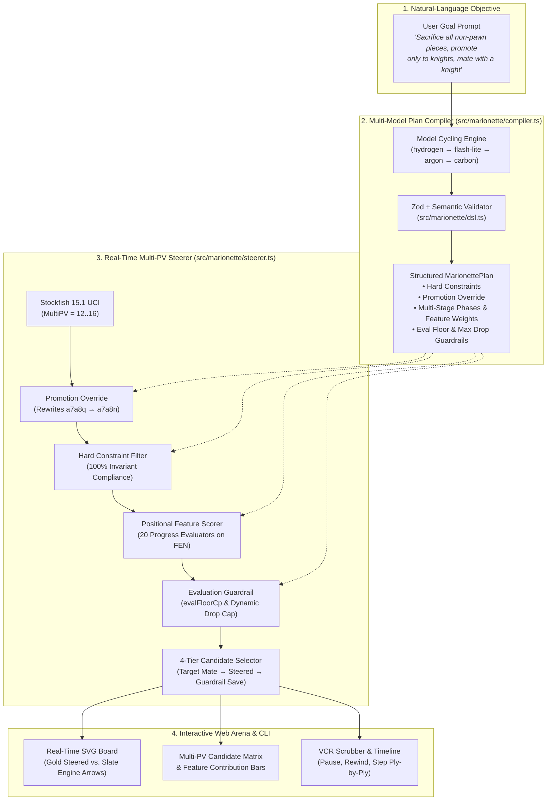
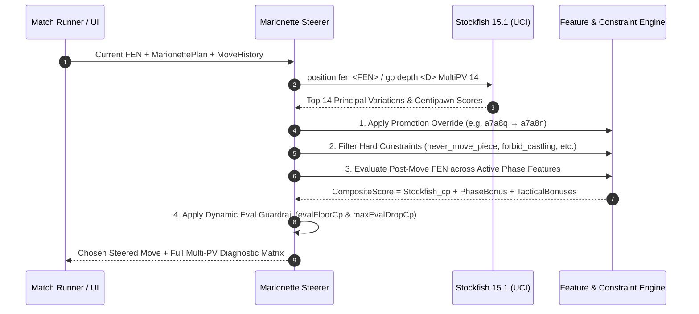

# Marionette — Goal-Directed Stockfish

Marionette is a chess steering engine and real-time visualization platform that takes any natural-language chess objective—such as *"win by giving up every piece except pawns, promote all of them to knights, then checkmate with a knight"*—and steers Stockfish 15.1 toward fulfilling that plan while maintaining a winning evaluation.

---

## System Architecture



---

## How the Steering Loop Works

On every turn, Marionette queries Stockfish 15.1 in `MultiPV` mode and processes the candidate moves through a four-stage decision flow:



---

## Arena Benchmark Ladder Summary

Full results and failure analysis are documented in [`RESULTS.md`](./RESULTS.md).

| Ladder Rung | Objective Prompt | Opp Elo | W / D / L | Win % | Goal Achieved % | Loss % | Hard Violations |
| :--- | :--- | :---: | :---: | :---: | :---: | :---: | :---: |
| **1. Sanity** | `"just win"` | 2400 | 10 / 0 / 0 | **100%** | **100%** | **0%** | 0 |
| **2a. Easy Style** | `"deliver checkmate with a knight"` | 2000 | 2 / 3 / 0 | **40%** | **40%** | **0%** | 0 |
| **2b. Easy Style** | `"deliver checkmate with a knight"` | 2400 | 3 / 2 / 0 | **60%** | **60%** | **0%** | 0 |
| **3. Medium** | `"win without ever moving the queen"` | 2200 | 4 / 1 / 0 | **80%** | **80%** | **0%** | 0 |
| **4a. Hard (Headline)** | `"sacrifice all non-pawn pieces, promote only to knights, mate with a knight"` | 1800 | 3 / 1 / 0 | **75%** | **75%** | **0%** | 0 |
| **4b. Hard (Headline)** | `"sacrifice all non-pawn pieces, promote only to knights, mate with a knight"` | 2000 | 2 / 2 / 0 | **50%** | **50%** | **0%** | 0 |
| **4c. Hard (Headline)** | `"sacrifice all non-pawn pieces, promote only to knights, mate with a knight"` | 2200 | 1 / 3 / 0 | **25%** | **25%** | **0%** | 0 |
| **4d. Hard (Headline)** | `"sacrifice all non-pawn pieces, promote only to knights, mate with a knight"` | 2400 | 1 / 3 / 0 | **25%** | **25%** | **0%** | 0 |
| **5. Out-of-Distribution** | `"Never castle, march the king up the board, and deliver checkmate with a knight"` | 2000 | 2 / 2 / 0 | **50%** | **50%** | **0%** | 0 |
| **Total / Aggregate** | **45 Arena Matches** | **1800–2400** | **28 / 17 / 0** | **62.2%** | **62.2%** | **0.0%** | **0** |

---

## Quick Start & Setup

### Prerequisites
- **Node.js**: v22+
- **Stockfish**: Native `stockfish` binary (`/usr/games/stockfish` or `/usr/local/bin/stockfish`)
- **Environment**: Set `GEMINI_API_KEY` in `.env`

### Installation & Running
```bash
# 1. Install dependencies
npm install

# 2. Run the unit, property, and compiler test suite
npm test

# 3. Start the Real-Time Game Visualizer & Objective Studio on http://localhost:3000
npm run dev
```

### CLI Usage (`marionette play` / `marionette compile`)
```bash
# Play a full match from the terminal with a real LLM and real Stockfish
npx tsx src/marionette/cli.ts play \
  --goal "sacrifice all non-pawn pieces, promote only to knights, mate with a knight" \
  --elo 2000 --depth 8

# Compile any natural-language goal into a validated MarionettePlan JSON spec
npx tsx src/marionette/cli.ts compile \
  --goal "Never castle, march the king up the board, and deliver checkmate with a knight"

# Run the full 9-rung Arena Benchmark Ladder
npx tsx src/marionette/run-ladder.ts
```

---

## Documentation Index

- **[`RESULTS.md`](./RESULTS.md)**: Full 9-rung integration ladder numbers, Pass 1 vs. Pass 2 guardrail calibration log, and technical analysis of why hard goals draw against high-Elo opponents.
- **[`docs/ARCHITECTURE.md`](./docs/ARCHITECTURE.md)**: Detailed steering architecture, 4-tier candidate selection flowchart, composite scoring equation, and multi-stage phase state diagrams.
- **[`docs/DSL_REFERENCE.md`](./docs/DSL_REFERENCE.md)**: Complete reference for `MarionettePlan`, hard constraints, promotion overrides, and all 20 positional progress features.

---

## How to Add New Goals or Progress Features

1. **Via the Web UI (Objective Studio)**:
   Open the **Objective Studio** tab, type any natural-language goal, select a primary model, and click **Compile Objective to DSL**. You can also edit the JSON weights, phases, and constraints directly in the live schema validator and click **Watch in Live Arena**.
2. **Adding a New Preset Fixture Goal**:
   Append a `FixtureGoal` object to `FIXTURE_GOALS` in `src/marionette/compiler.ts` and run `npm test`.
3. **Adding a New Progress Feature**:
   - Add the feature identifier to `ProgressFeatureTypeSchema` in `src/marionette/dsl.ts`.
   - Implement its FEN evaluation logic in `computeFeatureValue` inside `src/marionette/features.ts`.
   - Add a hand-written FEN unit test in `src/marionette/marionette.test.ts`.
