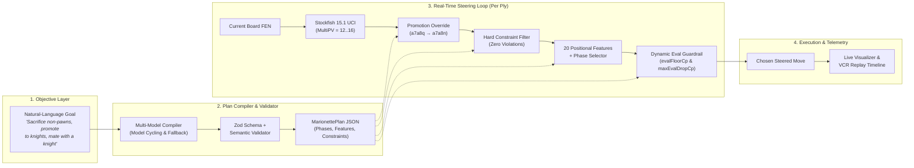
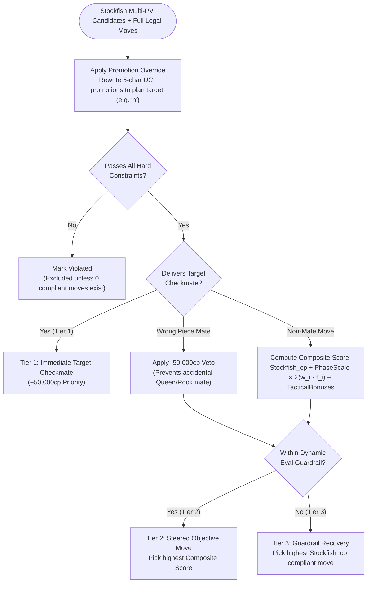
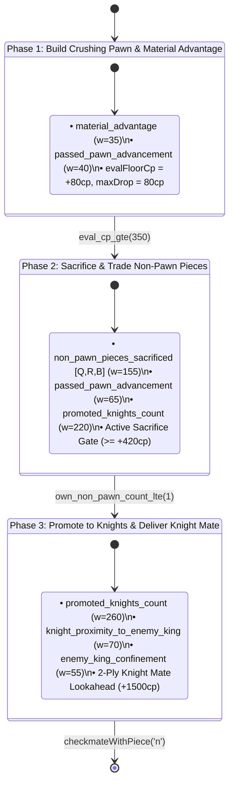

# Marionette Architecture & Steering Mechanics

Marionette decouples **strategic objective planning** from **tactical move calculation**. Rather than asking a language model to output raw algebraic chess moves—which degrades rapidly in tactical positions—Marionette compiles natural-language goals into a verified `MarionettePlan` state machine and uses Stockfish 15.1's Multi-PV search to evaluate and steer legal candidates on every ply.

---

## 1. End-to-End System Pipeline

---

## 2. Four-Tier Candidate Selection Hierarchy

On every turn, `selectSteeredMove` (`src/marionette/steerer.ts`) receives the current FEN, Stockfish's top `MultiPV` candidates, and the active `MarionettePlan`. Each legal move is evaluated through a strict 4-tier hierarchy:

### The Composite Scoring Equation

For any constraint-compliant move $m$ leading to post-move position $\text{FEN}(m)$:

$$\text{CompositeScore}(m) = \text{Eval}_{\text{SF}}(m) + \alpha_{\text{phase}} \sum_{i} w_i \cdot \phi_i(\text{FEN}(m)) + B_{\text{sacrifice}}(m) + B_{\text{promo}}(m) + B_{\text{threat}}(m) - P_{\text{veto}}(m)$$

Where:
- $\text{Eval}_{\text{SF}}(m)$: Stockfish centipawn evaluation from Marionette's perspective.
- $\alpha_{\text{phase}} \in [0.05, 1.0]$: Dynamic phase scaling factor ($0.35$ when $\text{Eval}_{\text{SF}} < +180\text{cp}$ so Marionette plays rock-solid openings before pursuing stylistic maneuvers).
- $w_i \cdot \phi_i(\text{FEN}(m))$: Weighted contribution of each active progress feature in the current phase.
- $B_{\text{sacrifice}}(m)$: Active piece-offering bonus when `non_pawn_pieces_sacrificed` is active, Marionette is ahead by $\ge +420\text{cp}$, and at least one pawn remains on the board.
- $B_{\text{promo}}(m)$: $+900\text{cp}$ bonus when $m$ underpromotes to the plan's target piece.
- $B_{\text{threat}}(m)$: $+1,500\text{cp}$ 2-ply lookahead bonus when $m$ sets up an unstoppable mate-in-1 with `terminal.checkmateWithPiece`.
- $P_{\text{veto}}(m)$: $-50,000\text{cp}$ penalty if $m$ delivers checkmate with the *wrong* piece, or $-25,000\text{cp}$ if $m$ triggers stalemate/draw while ahead.

---

## 3. Multi-Stage Phase Transitions

Complex goals—such as the headline challenge (*"sacrifice all non-pawn pieces, promote only to knights, mate with a knight"*)—cannot be expressed with static weights throughout an entire game. Sacrificing a Queen on move 6 simply loses the game.

Marionette solves this with sequential `PlanPhase` transitions:

