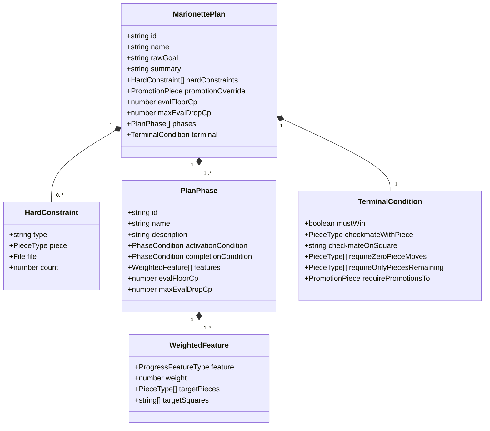

# MarionettePlan DSL Specification Reference

The `MarionettePlan` Domain-Specific Language (`src/marionette/dsl.ts`) defines the contract between the natural-language goal compiler and the deterministic Stockfish Multi-PV steerer.

---

## 1. Schema Structure Overview

---

## 2. Hard Constraints (`HardConstraint`)

Hard constraints act as strict boolean filters on legal moves (`checkHardConstraints` in `src/marionette/steerer.ts`). Whenever at least one compliant legal move exists in a position, a hard constraint is **never** violated.

| Constraint Type | Parameters | Semantics |
| :--- | :--- | :--- |
| `never_move_piece` | `piece: "p" \| "n" \| "b" \| "r" \| "q" \| "k"` | Forbids moving any own piece of the specified type for the entire game. |
| `never_capture_with` | `piece: "p" \| "n" \| "b" \| "r" \| "q" \| "k"` | Allows moving the piece, but forbids capturing any opponent piece (including en passant) with it. |
| `forbid_castling` | *(none)* | Forbids both kingside (`O-O`) and queenside (`O-O-O`) castling. |
| `promote_only_to` | `piece: "n" \| "b" \| "r" \| "q"` | Forbids promoting a pawn to any piece other than `piece`. |
| `never_move_file_pawn` | `file: "a".."h"` | Freezes pawns originating on the specified file. |
| `max_queen_moves` | `count: 0..50` | Caps the cumulative number of Queen moves allowed in a game. |

---

## 3. Positional Progress Features (`ProgressFeatureType`)

Each `WeightedFeature` inside a phase evaluates the resulting FEN position after a candidate move (`computeFeatureValue` in `src/marionette/features.ts`) and multiplies the scalar value by `weight` ($\in [-500, 500]$) to compute a centipawn bonus:

| Feature Identifier | Return Range | Description |
| :--- | :---: | :--- |
| `non_pawn_pieces_sacrificed` | $0 \dots 7$ | Count of own starting non-pawn, non-king pieces (or `targetPieces`) that have been sacrificed or traded off. |
| `pawn_advancement` | $0 \dots 48$ | Sum of rank advancement across all own pawns, with exponential bonus on ranks 5–7. |
| `passed_pawn_advancement` | $0 \dots 60$ | Advancement score of passed pawns (unopposed by enemy pawns on same or adjacent files). |
| `promoted_knights_count` | $0 \dots 8$ | Cumulative count of pawns underpromoted to Knights. |
| `knight_count` | $0 \dots 10$ | Total number of own Knights currently on the board. |
| `bishop_count` | $0 \dots 10$ | Total number of own Bishops currently on the board. |
| `rook_count` | $0 \dots 10$ | Total number of own Rooks currently on the board. |
| `queen_count` | $0 \dots 9$ | Total number of own Queens currently on the board. |
| `knight_proximity_to_enemy_king` | $0 \dots 50$ | Sum of $(10 - d_{\text{Manhattan}})$ from each own Knight to the opponent's King. |
| `enemy_king_confinement` | $0 \dots 7.0$ | Distance of the enemy King from the center $(3.5, 3.5)$, rewarding herding the King to the edge/corner. |
| `queen_on_starting_square` | $0 \text{ or } 1$ | $1$ if own Queen remains anchored on `d1` (White) or `d8` (Black). |
| `center_control` | $0 \dots 12$ | Occupation score of central squares (`d4, e4, d5, e5` $= 2\text{pt}$; `c4, f4, c5, f5` $= 1\text{pt}$). |
| `custom_square_occupation` | $0 \dots N$ | Count of squares in `targetSquares` occupied by own pieces (optionally filtered by `targetPieces`). |
| `king_walk_advancement` | $0 \dots 7$ | How many ranks own King has marched forward from its back rank. |
| `edge_file_control` | $0 \dots 16$ | Count of own pieces occupying the `a` and `h` flank files. |
| `castled_kingside` | $0 \text{ or } 1$ | $1$ if King has castled kingside (`g1/h1` with Rook to its left). |
| `castled_queenside` | $0 \text{ or } 1$ | $1$ if King is positioned on `c1/b1` (White) or `c8/b8` (Black). |
| `material_advantage` | $-39 \dots +39$ | Standard material differential ($\text{P}=1, \text{N}=3, \text{B}=3, \text{R}=5, \text{Q}=9$). |
| `opponent_pieces_captured` | $0 \dots 15$ | Count of captured enemy pieces. |
| `checks_delivered_bonus` | $0 \text{ or } 1$ | $1$ if the candidate move places the opponent's King in check. |

---

## 4. Semantic Validation Rules

In addition to structural type-checking, `validatePlan` rejects logically contradictory plans:
1. **Conflicting Promotion Rules**: If both `promotionOverride` and a `promote_only_to` hard constraint are specified with different target pieces (e.g., `promotionOverride: "n"` and `promote_only_to: "q"`), validation fails.
2. **Contradictory Terminal & Hard Constraints**: If `terminal.checkmateWithPiece` requires piece $X$ while `hardConstraints` contains `never_move_piece(X)`, validation fails.
3. **Unique Phase Identifiers**: Every phase in `phases` must have a distinct `id` and `phases` must be non-empty.
